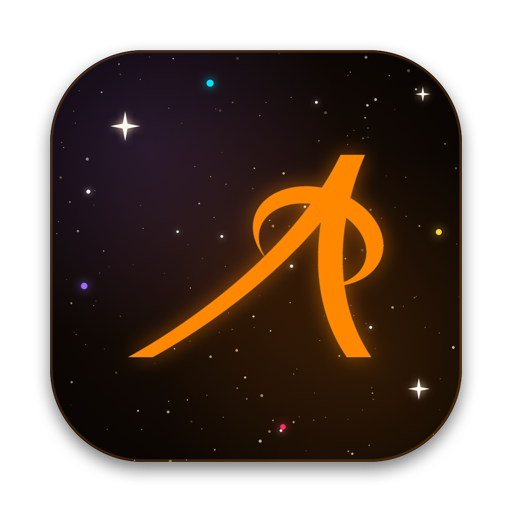
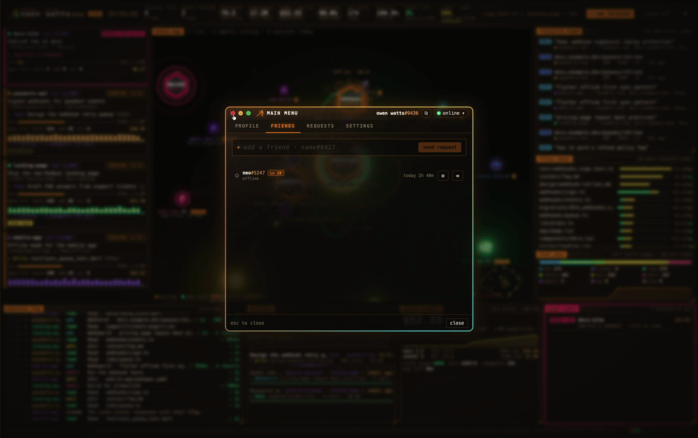
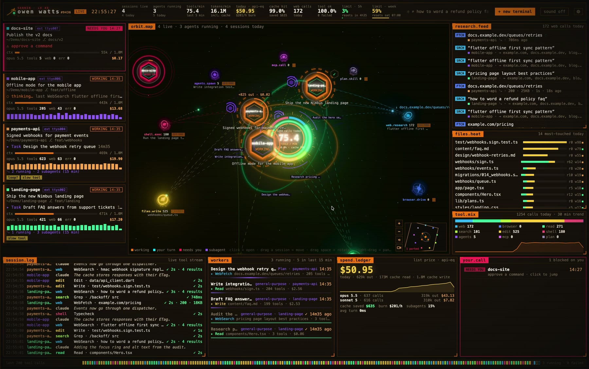
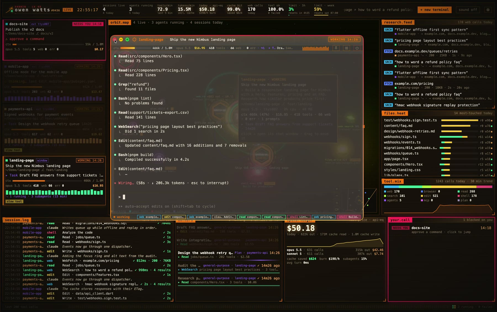
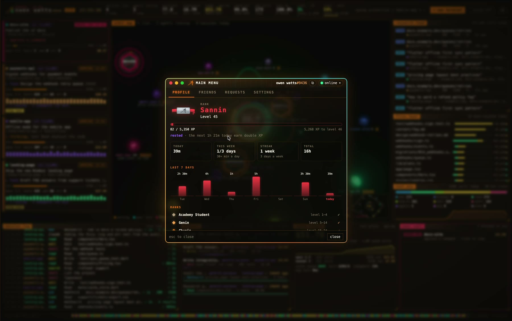
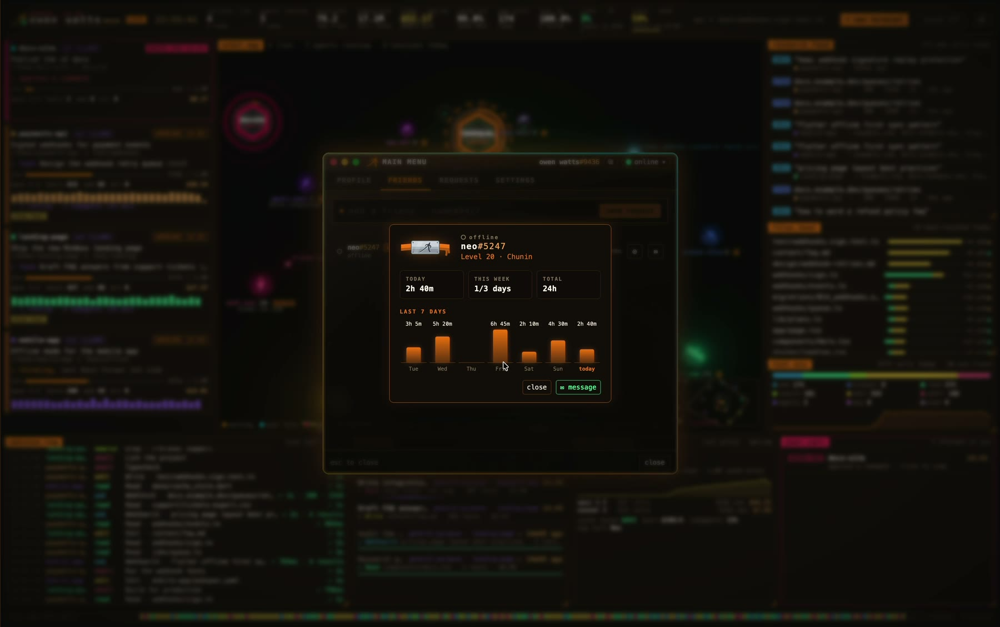

  

<h1 align="center">Atalay's Terminal</h1>

  A HUD for your Claude Code sessions on the Mac and on Windows: every chat on a live orbit map, terminals as flying cars, friends and messages.

  <a href="https://github.com/atalaykarahan/atalay-terminal-releases/releases/latest/download/Atalays-Terminal.dmg"><b>⬇&nbsp; Download for macOS</b></a>
  &nbsp;·&nbsp;
  <a href="https://github.com/atalaykarahan/atalay-terminal-releases/releases/download/windows/Atalays-Terminal-Setup.exe"><b>⬇&nbsp; Download for Windows</b></a>
  &nbsp;·&nbsp;
  <a href="https://github.com/atalaykarahan/atalay-terminal-releases/releases">All versions</a>
  &nbsp;·&nbsp;
  <a href="https://github.com/atalaykarahan/atalay-terminal">Source code</a>

macOS 13 or later (Apple Silicon and Intel) · Windows 10 or 11 (64-bit) · works with Claude Code

  

<table>
  <tr>
    <td width="50%"></td>
    <td width="50%"></td>
  </tr>
  <tr>
    <td><b>Every session on one screen.</b> Chats orbit while they work; subagents, tool calls, files, web research and spend update live, and the ones that need you glow red.</td>
    <td><b>Each chat in its own window</b>, running in the background: close it or quit the app and Claude keeps working.</td>
  </tr>
  <tr>
    <td></td>
    <td></td>
  </tr>
  <tr>
    <td><b>Levels and ranks</b> for the time you actively work, from Academy Student up to Kage.</td>
    <td><b>Friends:</b> their level, and how many hours they worked each day.</td>
  </tr>
</table>

---

## Install

### macOS

1. Download **Atalays-Terminal.dmg** (link above) and open it.
2. Drag **Atalay's Terminal** onto **Applications**.
3. Open it from Applications.

The app isn't notarized by Apple yet, so the first time macOS says it can't verify it. Allow it once:

- **System Settings → Privacy & Security**, scroll down to *Security* and click **Open Anyway** next to Atalay's Terminal, then **Open**.
- Or in Terminal: `xattr -dr com.apple.quarantine "/Applications/Atalay's Terminal.app"`

### Windows

1. Download **Atalays-Terminal-Setup.exe** (link above). If the browser says the file isn't commonly downloaded, keep it (in Edge: **…** next to it, **Keep**, **Show more**, **Keep anyway**).
2. Run it. The installer isn't code-signed yet, so Windows may say it protected your PC: click **More info**, then **Run anyway**. It installs for your Windows user only (no administrator needed) and opens the app.
3. Chats need Claude Code on the PC (in PowerShell: `irm https://claude.ai/install.ps1 | iex`); Source Control needs [Git for Windows](https://git-scm.com/download/win).

## Updates

You only download it once. When a new version is out, the app tells you and shows what's new; one click installs it and restarts the app, and your chats keep running. On the Mac every update is signed, and the app checks the signature before it installs anything; on Windows, until the app is code-signed, it checks each download against the checksum published with it.

## Privacy

- The dashboard reads Claude Code's own files on your Mac (`~/.claude`: the session list and transcripts), read only. None of it leaves your Mac: no prompts, no code, no transcripts, no file names, no token counts.
- The app talks to its server only for the social parts and updates: your hacker name and tag, the app and macOS version, whether you're working each minute (for XP) and your time zone, your friends, requests, messages and status, and the leaderboard.
- Your Mac is known to the server by a salted hash of its hardware UUID (never the UUID itself) and a random token kept on the Mac.
- On Windows the same goes for your PC: Claude Code's files are in `%USERPROFILE%\.claude`, the server gets the Windows version, and the PC is known by a salted hash of Windows' MachineGuid.
- Messages are stored on the server so they reach your friends; they aren't end-to-end encrypted.
- Settings can hide your active time from friends and your name on the leaderboard.
- No analytics or tracking libraries. The app's source code is open: [atalaykarahan/atalay-terminal](https://github.com/atalaykarahan/atalay-terminal).

---

## Türkçe

**Kurulum (macOS)**

1. Yukarıdaki **Download for macOS** bağlantısından **Atalays-Terminal.dmg**'yi indirip aç.
2. **Atalay's Terminal**'i **Applications** klasörüne sürükle.
3. Applications'tan aç.

Uygulama henüz Apple'a notarize edilmediği için macOS ilk açılışta "doğrulanamadı" der. Bir kez izin ver:

- **Sistem Ayarları → Gizlilik ve Güvenlik**, en alta in ve Atalay's Terminal'in yanındaki **Yine de Aç**'a, sonra **Aç**'a bas.
- Ya da Terminal'de: `xattr -dr com.apple.quarantine "/Applications/Atalay's Terminal.app"`

**Kurulum (Windows)**

1. Yukarıdaki **Download for Windows** bağlantısından **Atalays-Terminal-Setup.exe**'yi indir. Tarayıcı dosyanın yaygın olarak indirilmediğini söylerse sakla (Edge'de: yanındaki **…**, **Sakla**, **Daha fazla göster**, **Yine de sakla**).
2. Çalıştır. Kurulum dosyası henüz kod imzalı olmadığı için Windows bilgisayarını koruduğunu söyleyebilir: **Ek bilgi**'ye, sonra **Yine de çalıştır**'a bas. Sadece senin Windows kullanıcına kurulur (yönetici izni gerekmez) ve uygulamayı açar.
3. Sohbetler için PC'de Claude Code olmalı (PowerShell'de: `irm https://claude.ai/install.ps1 | iex`); Source Control için [Git for Windows](https://git-scm.com/download/win) gerekir.

**Güncellemeler**

Bir kez indirmen yeter. Yeni sürüm çıkınca uygulama haber verir ve yenilikleri gösterir; tek tıkla kurulur, uygulama yeniden açılır, sohbetlerin çalışmaya devam eder. Mac'te her güncelleme imzalıdır, uygulama kurmadan önce imzayı kontrol eder; Windows'ta, uygulama kod imzalı olana kadar, her indirmeyi yanında yayınlanan sağlama toplamıyla karşılaştırır.

**Gizlilik**

- Pano, Claude Code'un Mac'indeki kendi dosyalarını (`~/.claude`: oturum listesi ve transcript'ler) sadece okur. Hiçbiri Mac'inden çıkmaz: prompt, kod, transcript, dosya adı ya da token sayısı gönderilmez.
- Uygulama sunucusuyla sadece sosyal kısımlar ve güncellemeler için konuşur: hacker adın ve etiketin, uygulama ve macOS sürümü, her dakika çalışıp çalışmadığın (XP için) ve saat dilimin, arkadaşların, istekler, mesajlar ve durumun, bir de leaderboard.
- Sunucu Mac'ini, donanım kimliğinin tuzlanmış bir hash'i (kimliğin kendisi asla değil) ve Mac'inde duran rastgele bir token ile tanır.
- Windows'ta da aynısı PC'n için geçerli: Claude Code'un dosyaları `%USERPROFILE%\.claude`'dadır, sunucuya Windows sürümü gider, PC'n Windows'un MachineGuid'inin tuzlanmış bir hash'iyle tanınır.
- Mesajlar arkadaşlarına ulaşsın diye sunucuda saklanır; uçtan uca şifreli değildir.
- Ayarlardan aktif süreni arkadaşlarından, adını leaderboard'dan gizleyebilirsin.
- Hiçbir analitik ya da takip kütüphanesi yok. Uygulamanın kaynak kodu açık: [atalaykarahan/atalay-terminal](https://github.com/atalaykarahan/atalay-terminal).
